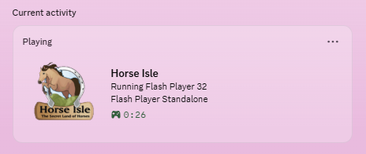

# Flash Rich Presence

A small Windows tool that shows a **Discord Rich Presence** status ("Playing Flash Player…") while the Adobe Flash Player standalone projector (`flashplayer_32_sa.exe`) is running. It clears the status when the player closes.

> **Not affiliated with Adobe or Discord.** Flash Player is end-of-life software. This project does not include, host, or distribute Flash Player.


<!-- Replace screenshot.png with a real screenshot of your Discord profile showing the status. -->

## Requirements

- Windows only for now
- The **Discord desktop app**, running (the browser and mobile versions can't show Rich Presence)
- In Discord: *User Settings → Activity Privacy → Share my detected activity* turned **on**
- Your Discord status must **not** be set to Invisible
- Your own copy of the Flash Player standalone projector

## Install

### Option A: Download the exe (easiest)

1. Download `flash_presence.exe` and `config.json` from the [latest release](../../releases/latest) and put them in the same folder.
2. Double-click `flash_presence.exe`. It runs silently in the background.
3. Open Flash Player. Your Discord status should update within a few seconds.

Windows SmartScreen or your antivirus may warn about the exe because it isn't code-signed. See [Verifying the download](#verifying-the-download), or use Option B.

### Option B: Run from source

1. Install [Python 3.9+](https://www.python.org/downloads/) and tick **Add python.exe to PATH** during setup.
2. Download or clone this repo.
3. In Command Prompt (not the Python `>>>` prompt), go to the project folder and run:
   ```
   python -m pip install -r requirements.txt
   python flash_presence.py
   ```
   To run with no console window, rename the file to `flash_presence.pyw` and open it with `pythonw.exe`.

### Run at login

Press **Win+R**, type `shell:startup`, and put a shortcut to `flash_presence.exe` in the folder that opens.

### Stop it

Open Task Manager → *Background processes* and end `flash_presence.exe` (or `Python` if you ran the script). If you started it from a console window, press **Ctrl+C**.

## Configuration

Edit `config.json` (next to the exe or script). Restart the program after changing it.

| Key | Default | Meaning |
|---|---|---|
| `client_id` | the project's ID | Discord Application ID. The app's name is what shows as "Playing ___". |
| `process_prefix` | `flashplayer` | Matches any process whose name starts with this (case-insensitive). |
| `poll_interval` | `5` | Seconds between checks for the process. |
| `min_update_gap` | `15` | Minimum seconds between status updates (Discord rate-limits updates; values below 15 are raised to 15). |
| `reconnect_delay` | `15` | Seconds between attempts to find Discord. |
| `show_window_title` | `false` | Show the player's window title (often the open `.swf` name). Needs `pywin32`. May reveal file names, so it is off by default. |
| `large_image` | `flash_logo` | Art asset key uploaded in the Developer Portal. Use `null` for no image. |
| `large_text` | `Adobe Flash Player 32` | Tooltip shown when hovering the image. |
| `details` | `Running Flash Player 32` | First line of the status. |
| `state` | `Flash Player Standalone` | Second line of the status. |

### Use your own Discord application

If you fork this project, create your own app so the name and art are yours:

1. Go to the [Discord Developer Portal](https://discord.com/developers/applications) and click **New Application**. The name you pick shows as "Playing ___".
2. Copy the **Application ID** into `client_id` in `config.json`.
3. Under *Rich Presence → Art Assets*, upload a square image (512×512 or larger) and set its key to match `large_image`. New assets can take a few minutes to appear.

## Troubleshooting

The program writes `flash_presence.log` next to the exe/script. Check it first.

| Log says | What it means |
|---|---|
| `Connected to Discord` only | Discord is reachable, but the player wasn't detected. Check the process name with `tasklist \| findstr /i flash` and adjust `process_prefix`. |
| `Discord unavailable… retrying` | The Discord desktop app isn't running. It will keep retrying. |
| `client_id must be…` / `Invalid client_id` | The Application ID is wrong. |
| `Presence updated` but nothing in Discord | Check *Activity Privacy*, make sure you aren't Invisible, and view your profile from another account. |

Other tips:

- Run Discord and this program at the **same privilege level** (both normal, or both as administrator).
- If Discord was restarted, the program reconnects on its own; no need to relaunch it.
- If nothing runs at all when you double-click a `.py` file, open Command Prompt in the folder and run `python flash_presence.py` to see any error.

## Building the exe yourself

```
python -m pip install -r requirements.txt pyinstaller
pyinstaller --noconsole --onefile flash_presence.py
```

The exe appears in `dist/`. Ship `config.json` next to it.

## Verifying the download

Each release lists the exe's SHA-256 hash. To check yours:

```
certutil -hashfile flash_presence.exe SHA256
```

The output should match the hash in the release notes. You can also read the full source in this repo (it is a single short file) or build the exe yourself.

## Privacy

The program only reads the list of running process names on your PC and sends the status text you configured to your local Discord client. Nothing is sent anywhere else. With `show_window_title` turned on, the open window's title is included in your status, which others can see.

## License

[MIT](LICENSE)
